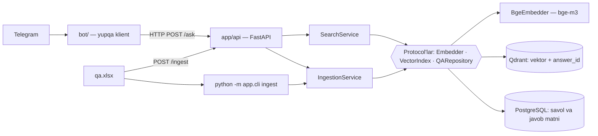

# 1-topshiriq. Semantik qidiruvga asoslangan savol-javob tizimi

Foydalanuvchi savolni o'z so'zlari bilan yozadi: lotin yoki kirill yozuvida, ruscha, imlo xatolari bilan. Tizim Excel'dan yuklangan savol-javoblar orasidan ma'no jihatidan eng yaqin javobni topadi. Mos javob bo'lmasa, `found: false` qaytaradi va "topilmadi" deb aniq aytadi. Interfeyslar: REST API (FastAPI) va Telegram bot.

**Stek:** bge-m3 (embedding) · Qdrant (vektor baza) · PostgreSQL (asosiy ma'lumot manbai) · FastAPI · aiogram 3 · Docker Compose.

Barcha hisob-kitob lokal bajariladi, ma'lumot tashqi bulut xizmatlariga yuborilmaydi.

## Arxitektura



Bog'liqliklar faqat ichkariga yo'nalgan: `api / cli / bot → services → domain`. `adapters` `domain`dagi Protocol'larni amalga oshiradi. Barcha obyektlar bitta joyda — `app/container.py`da yig'iladi. Og'ir resurslar (model, PostgreSQL connection pool, Qdrant klienti) dastur ishga tushganda bir marta yaratiladi (FastAPI `lifespan`).

| Modul | Nima uchun bor |
|---|---|
| `app/domain/models.py` | Pydantic DTO'lar: `QAPair`, `Question`, `Answer`, `SearchResult`, `IngestReport`. |
| `app/domain/ports.py` | Tashqi chegaralar uchun 3 ta kichik Protocol: `Embedder`, `VectorIndex`, `QARepository`. |
| `app/domain/text.py` | `normalize()` (kichik harf, bo'shliqlar, `ʻ ' ‘ \`` → `'`) va `stable_id()` (matndan barqaror UUID). |
| `app/domain/errors.py` | Domen xatolari. `api/main.py` ularni HTTP kodlarga o'giradi. |
| `app/services/ingestion.py` | Dublikatlarni olib tashlash → PostgreSQL'ga upsert → o'zgargan savollarni partiyalab embed qilish → Qdrant'ga upsert. |
| `app/services/search.py` | Normalizatsiya → embed → top-k → har bir javob uchun eng yaxshi ball → chegara → PostgreSQL'dan matn olish. |
| `app/adapters/*` | bge-m3, Qdrant, PostgreSQL (psycopg 3 + pool) va Excel (openpyxl) bilan ishlash. |
| `app/api/*` | `POST /ask`, `POST /ingest`, `GET /health`. Domen xatolari uchun bitta exception handler. |
| `app/cli.py` | Buyruq qatoridan ingestion. |
| `bot/*` | API'ga HTTP orqali murojaat qiluvchi bot. `app` paketini import qilmaydi (buni test tekshiradi), o'zining yengil Docker image'i bor (torch'siz). |
| `eval/*` | Baholash to'plami va skripti. Natijalar [EVALUATION.md](EVALUATION.md)da. |

### Ma'lumot modeli va idempotentlik

- `answers(id uuid, text)` va `questions(id uuid, answer_id, text)` — PostgreSQL, asosiy ma'lumot manbai.
- ID = normalizatsiya qilingan matndan olingan `uuid5`. Bir xil savol har doim bir xil ID oladi, shuning uchun qayta yuklash dublikat yaratmaydi (upsert).
- Qdrant'da har bir savol uchun bitta nuqta saqlanadi: ID = savol ID'si, payload = faqat `answer_id`. Matnlar faqat PostgreSQL'da turadi.
- Qayta yuklashda faqat yangi yoki javobi o'zgargan savollar qayta embed qilinadi. 3048 ta savolni birinchi marta yuklash CPU'da taxminan 7 daqiqa oladi, takroriy yuklash taxminan 2 soniya.

## Ishga tushirish

```bash
cp .env.example .env          # TELEGRAM_BOT_TOKEN ni kiriting
docker compose up --build
```

Compose quyidagilarni ko'taradi:
1. PostgreSQL va Qdrant;
2. bir martalik `ingest` servisi (`data/qa.xlsx`ni yuklaydi);
3. API (`http://localhost:8000/docs`);
4. bot.

Birinchi ishga tushirishda bge-m3 modeli (~2.3 GB) `hf_cache` volume'ga yuklab olinadi.

### Lokal ishga tushirish (Docker'siz)

```bash
python -m venv .venv && . .venv/bin/activate
pip install -e ".[api,bot,dev]" --extra-index-url https://download.pytorch.org/whl/cpu
docker compose up -d postgres qdrant
python -m app.cli ingest data/qa.xlsx
uvicorn app.api.main:create_app --factory --port 8000
python -m bot.main            # alohida terminalda
```

### API

```bash
curl -X POST localhost:8000/ask -H 'Content-Type: application/json' \
     -d '{"question": "pasportimni almashtirmoqchiman qayerga borishim kerak"}'
# {"found": true, "answer": "Ariza my.gov.uz portali orqali ...", "matched_question": "Pasportni (ID-karta) almashtirish qanday?", "score": 0.799}

curl -X POST localhost:8000/ask -H 'Content-Type: application/json' -d '{"question": "Palov qanday tayyorlanadi?"}'
# {"found": false, "answer": null, "matched_question": null, "score": 0.533}

curl -X POST localhost:8000/ingest -F "file=@data/qa.xlsx"
# {"rows_read": 3048, "rows_skipped": 0, "answers": 505, "questions": 3048, "newly_indexed": 0}
```

| Holat | HTTP kodi |
|---|---|
| Bo'sh savol, `.xlsx` bo'lmagan yoki buzilgan fayl, majburiy ustun yo'q, fayl juda katta | 422 |
| Qidiruv indeksi hali yaratilmagan (ingestion bajarilmagan) | 503 |
| Qdrant'da bor, lekin PostgreSQL'da yo'q savol (ma'lumot nomuvofiqligi) | 500 |

### Excel formati

Birinchi varaqda `question` va `answer` ustunlari bo'lishi shart (sarlavha qatori, katta-kichik harf farqi yo'q). Bo'sh savol yoki bo'sh javobli qatorlar tashlab ketiladi va qator raqami bilan logga yoziladi.

Berilgan arxivda ma'lumot ikki CSV ko'rinishida kelgan edi (`answers.csv` + `questions.csv`). Ular bir martalik konvertatsiya bilan `data/qa.xlsx`ga aylantirildi: 3048 savol, 505 javob.

## Testlar va sifat tekshiruvi

```bash
ruff check . && ruff format --check .
mypy app bot tests eval
pytest                         # 33 ta test
```

- **Unit testlar** servislarni Protocol'larning fake'lari bilan tekshiradi (`tests/fakes.py`), model va baza kerak emas.
- **`tests/integration/`** haqiqiy PostgreSQL va Qdrant bilan ishlaydi. Agar ular ishlamayotgan bo'lsa, bu testlar avtomatik o'tkazib yuboriladi (skip).

## Baholash

```bash
python -m eval.evaluate        # ingestion bajarilgan bo'lishi kerak
```

| Ko'rsatkich | Qiymat |
|---|---|
| Recall@1 | **0.734** |
| Recall@3 | **0.891** |
| MRR | **0.813** |
| Tanlangan chegara | **0.62** (F1 = 0.850) |

Batafsil: [EVALUATION.md](EVALUATION.md).

## Sozlamalar (`.env`)

| O'zgaruvchi | Standart qiymat | Ma'nosi |
|---|---|---|
| `DATABASE_URL` | `postgresql://qa:qa@localhost:5440/qa` | PostgreSQL ulanishi |
| `DATABASE_POOL_SIZE` | `5` | Ulanishlar havzasi (pool) hajmi |
| `QDRANT_URL` | `http://localhost:6333` | Qdrant manzili |
| `QDRANT_COLLECTION` | `qa_questions` | Kolleksiya nomi |
| `QDRANT_TIMEOUT_SECONDS` | `30` | Qdrant so'rovi uchun timeout |
| `EMBEDDING_MODEL` | `BAAI/bge-m3` | Embedding modeli |
| `EMBEDDING_DEVICE` | `cpu` | `cpu` yoki `cuda` |
| `EMBEDDING_BATCH_SIZE` | `32` | Partiya hajmi |
| `EMBEDDING_MAX_LENGTH` | `512` | Maksimal token soni |
| `SEARCH_CANDIDATES` | `20` | Qdrant'dan olinadigan nomzodlar soni (keyin javob bo'yicha guruhlanadi) |
| `MATCH_THRESHOLD` | `0.62` | Bundan past ball → `found: false`. Baholash natijasida tanlangan |
| `MAX_UPLOAD_MB` | `10` | `/ingest` uchun fayl hajmi chegarasi |
| `LOG_LEVEL` | `INFO` | Log darajasi |
| `TELEGRAM_BOT_TOKEN` | — | Bot tokeni |
| `API_BASE_URL` | `http://localhost:8000` | Bot murojaat qiladigan API manzili |
| `API_TIMEOUT_SECONDS` | `30` | Bot uchun API timeout |

## Cheklovlar

- **Faqat dense qidiruv.** Ruscha so'zlarni lotin harflarida yozish ("vid na jitelstvo", "ispytatelniy srok") va qisqartmalar ("pinfl") yomon ishlaydi. Yechim g'oyalari EVALUATION.md'da.
- **Mavzusi yaqin javoblar.** Bazada mavzusi bir-biriga juda yaqin javoblar bor, shuning uchun xatolarning qariyb yarmida to'g'ri javob 2-o'rinda turadi.
- **Eski yozuvlar o'chmaydi.** Excel'dan olib tashlangan savol-javoblar bazadan avtomatik o'chirilmaydi: ingestion faqat upsert qiladi.
- **Bitta varaq.** Excel faylning faqat birinchi varag'i o'qiladi.
- **Chegara cheklangan to'plamda tanlangan.** Chegara 239 ta savoldan iborat to'plamda tanlangan. Real foydalanuvchi savollari yig'ilgach, uni qayta kalibrovka qilish kerak.
